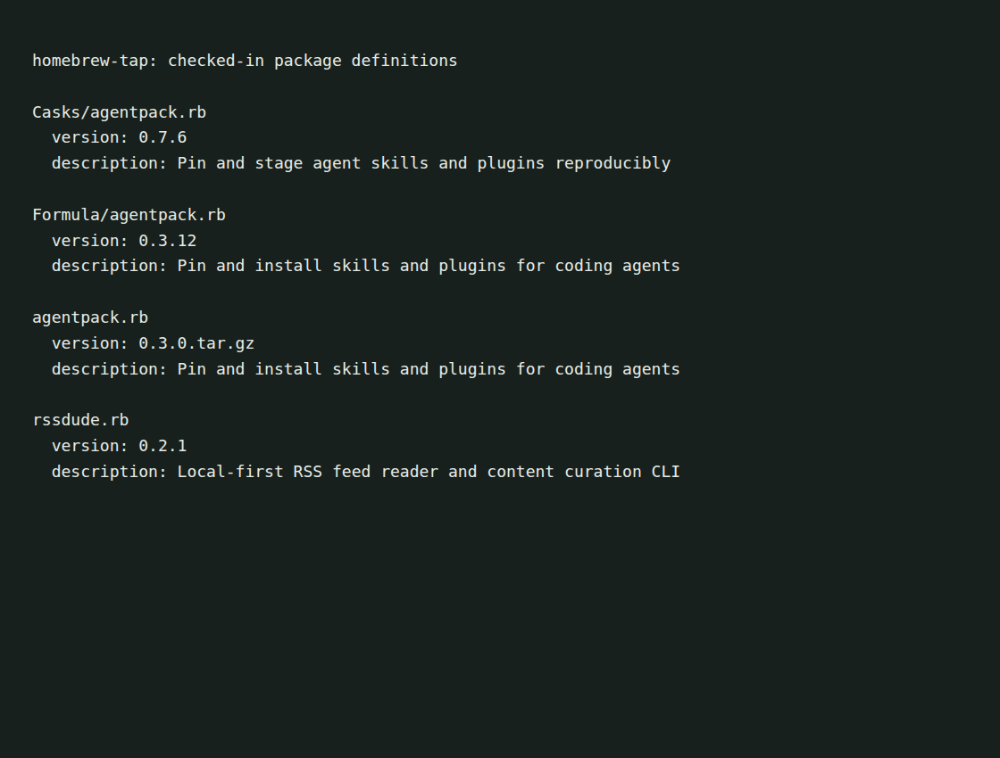

# olegpustovit Homebrew tap

Homebrew package definitions for [rssdude](https://github.com/olegpustovit/rssdude)
and [agentpack](https://github.com/olegpustovit/agentpack).



This is a capture of the checked-in definitions, not proof that a package was
installed. See [capture notes](docs/demo/README.md).

## Install

With Homebrew installed:

```sh
brew tap olegpustovit/tap
brew install olegpustovit/tap/rssdude
```

The rssdude definition currently points to v0.2.1 and provides an Apple Silicon
macOS archive. It explicitly rejects Intel macOS. No Linux archive is declared
in that definition.

For the agentpack cask on macOS:

```sh
brew install --cask olegpustovit/tap/agentpack
```

Use the cask qualifier to avoid the older formula with the same name.
Installation has not been verified by the capture.

## Definitions and versions

| File | Current purpose |
| --- | --- |
| [rssdude.rb](rssdude.rb) | rssdude v0.2.1 formula |
| [Casks/agentpack.rb](Casks/agentpack.rb) | Generated agentpack v0.7.6 binary cask |
| [Formula/agentpack.rb](Formula/agentpack.rb) | Older agentpack v0.3.12 binary formula |
| [agentpack.rb](agentpack.rb) | Older root-level agentpack definition |

The duplicate agentpack definitions are retained for compatibility and are not
interchangeable. A pinned version in this tap may be older than the upstream
release. Check the selected definition before installing or upgrading.

The generated cask is maintained by the upstream release process. Update that
process rather than hand-editing its generated file.
